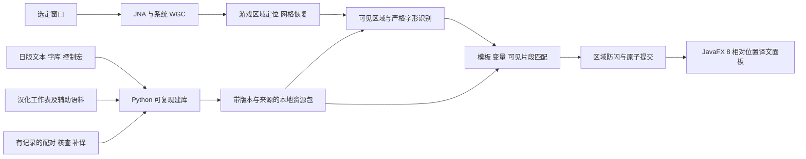

# 初代 VC 日版 OCR 翻译技术设计

状态：Q1–Q32 的已确认要求已经收束；本文与数据契约、验收方案、实施任务中的工程默认值一起提交最终共同理解确认。2026-10-18 尚无产品实现，目标指标均未实测。

## 结论与边界

方案具备继续实施验证的依据：字体、日版文本、中文工作表和系统窗口采集接口均有可用来源。核心是“还原游戏字形 → 匹配已知日文及变量 → 读取已构建中文”，运行时完全离线。三个尚未消除的风险是缩放画面的严格点阵恢复、Java 8 直接 WGC 绑定的稳定性与性能、日中对应及可见片段的覆盖程度。它们必须以原型和固定数据集证明。

目标为 Windows 本地工具，在独立窗口阅读日版《红、绿、蓝、皮卡丘》的当前可见文本。四作共用 OCR 和公共文本库，以红版先完成闭环，首版最终覆盖对白、战斗、背包、商店、PC、菜单。输入从已收到完整设备画面的采集软件开始，不依赖主机型号和投屏工具名称。

采集选定窗口，桌面其他窗口遮挡不影响输入；游戏内被菜单遮住的内容不识别、不补全。完整、比例正确、至少 160 × 144 的整数及非整数等比放大都在已确认范围内。自动定位游戏矩形并跟随窗口变化，人工框选仅兜底。最小化暂停，恢复后重新核验定位，关闭回到待选窗口状态。

## 系统分工

| 模块 | 输入与输出 | 必须守住的边界 |
| --- | --- | --- |
| capture | HWND → 自有 BGRA 缓冲、尺寸、时间与代次 | 不向上层泄漏 COM 指针；正确关闭帧、处理尺寸及失效 |
| locate / normalize | 有效窗口内容 → 游戏矩形、160 × 144 网格与点阵 | 多特征核验，不仅裁黑边；不把工具栏送入 OCR |
| glyph | 当前可见文字块 → 严格字形标识序列、未知位置 | 位图全等查表；共享假名保持等价，不猜近似字符 |
| corpus / match | 字形、布局、槽位、有限已见证据 → 可靠候选或明确失败 | 不依赖唯一来源 ID；不同中文不可强行归并 |
| display-state | 当前观测及候选 → 完整视图快照 | 暂留有时限，旧计算不得覆盖新页面 |
| ui | 快照 → 中文、原文、预览与状态 | 保持相对位置和阅读完整性，显示线程不做重计算 |
| tools/corpus | 固定上游来源 → 中间表示、核查报告、发布资源 | 自动匹配和大模型建议都不自动等于真值 |

工程默认采用 Maven 单工程和清晰包边界，纯识别、匹配、显示状态不依赖 JavaFX 或 JNA。先保持简单，可替换适配器；不为四作拆四套工程。资源格式及运行数据见 [数据契约](data-model.md)。

## 采集、线程与时间

一个 MTA 后台采集线程初始化 WinRT/D3D11，通过 CreateFreeThreaded 帧池和 TryGetNextFrame 主动取帧。该方法返回下一帧，不保证直接返回最新帧；实现需有界地跳过并归还旧帧，再对选定帧做昂贵的 CPU 读回，实测轮询间隔和帧龄。

成功 Map 后按 RowPitch 批量复制到自有 Java 缓冲，Unmap 前完成复制；包装原生指针的 ByteBuffer 不能当作副本。帧的 Close 与 COM 引用 Release 分别处理，异常路径也须释放，重建时先隔离旧代次。首关不要求实现 COM 事件委托，窗口状态轮询与错误处理仍须可靠。完整 ABI 路径见 [直接调用系统接口](capture-interop.md)。

采集到识别使用有界的最新帧槽，消费者处理不过来时替换待处理帧，不能积压整段历史。一个识别工作线程先完成闭环；没有测量依据不引入多级线程池。UI 使用一个待展示快照槽和合并的 JavaFX 提交任务；预览允许降频，不拖慢文字处理。

每个结果携带会话、采集代次、定位代次、页面上下文代次和观测序号。换目标、恢复、重建、重定位或切页使不适用结果失效；后台提交及 JavaFX 真正应用快照时都核验代次。帧来源时间、取帧时间、复制完成时间分别记录；来源 TimeSpan 是 QPC 时基的 100 ns 单位，不是原始 QPC 计数，也不直接等于首次可取时刻。时间校准、代理误差及实际显示测量见 [验收方案](validation.md)，不能到识别结束才计时。

## 严格识别与页面证据

先在有效窗口内容中找 10:9 游戏候选矩形，用网格、边界、色阶、已知文本框及字形联合核验。以确定的缩放变换、采样相位和二值化重建原始点阵，再对普通字体、战斗附加字形及浊点组合查表。非整数缩放的恢复算法是待验证实现问题；现有截图存在大量中间色，不能声称直接缩小就已解决。

文字分区依赖场景结构与当前实际遮挡：先得到可见区域、行和可用字格，再做字形匹配。不得透过菜单补回下层被挡文字。固定字形序列、变量约束、区域角色和可见布局用于检索。允许同页相邻帧、紧邻已见片段帮助定位滚动位置，但不能拼入未见后文。

短期上下文默认按以下规则隔离：目标、定位变换失效或菜单组结构改变时清理不相容证据；确认翻页或跳转时推进上下文代次；只有可核验的已见行重叠才能继承滚动证据。拿不准是否连续时放弃历史支持，继续依据当前画面。历史用于解释当前片段，不作为补全当前像素的授权。

候选必须通过当前可见固定字形、变量和片段范围核验。多个候选生成完全相同的中文及当前槽位值时可输出；生成不同中文而无足够证据时保留未确定。名字在库内有明确记录时翻译，否则保留当前日文；数字取当前画面。详见 [识别与匹配](matching-design.md)。

## 语料构建与中文原则

以日版反汇编的原文、宏和字体为基准；汉化工作簿作为既有中文来源；pret/pokered 与 poke-corpus 辅助建立跨语言关系。先按来源块导入，再用语义、控制宏、变量、场景和版本核查。不能按相同行号或相同短标签直接拼表。

原始内容、提取中间表示、配对结果、显示对齐和发布资源分层保留。共同内容合并，源位置与必要版本变体不丢。完整译文之外另建当前可见片段的中文绑定，不通过提前显示整段解决分页差异。

既有汉化表达为默认。严重改变关键事实、条件或操作结果且有日文证据时才修订，保留原译、修改、证据与撤回路径。措辞或文风偏好不能触发重译。缺失内容可在建库时补译，显示分段可保持用词和含义作重排，两者不得成为绕过修订门槛的途径。开发可用联网大模型辅助；应用运行时只读已构建资源。

## 展示及失败处理

按区域维护已提交正文。新完整结果确认后一次替换；短暂失败继续显示旧正文，首次不一致超过 150 ms 标记“更新中”，最长暂留 1 秒，反复失败不重置计时。有效画面确认无文字持续 150 ms 才清除。父子遮挡菜单组一起提交，其他区域独立更新。

过期后显示稳定等待状态及当前可识别日文，不能无限留旧译文。原文不完整时标出未知字格，不猜出整句。暂停可保留快照并明确标记。游标闪烁不触发正文更新；连续数值在受控刷新下使用同次观测的最新可靠值，不一直等待静止。

译文保留原区域相对锚点和顺序，尺寸适配中文，自动换行，可展开完整阅读。提供采集预览、原文查看、暂停与重试。布局和防闪细节见 [显示设计](display-design.md)。失败原因按 [验收分类](validation.md)记录，优先批量改进自动覆盖，不让用户承担逐条翻译的常规工作。

## 交付默认值与确认范围

以下为可调整的工程默认值，连同本文提交本轮总确认：Windows x64 应用目录或 ZIP，随附配套 Java 8/JavaFX 8、JNA 标准组件及预构建资源；用户免装 Python 和开发工具。首轮在已核查的本机 Windows 11 环境验收，WGC API 最低版本不等于已经承诺支持全部旧系统。

资源随发布包交付，首版按包更换资源，不引入在线更新或运行时翻译。诊断只落本地，保存失败类别、资源版本和可重放证据；应用不自动上传画面或日志。具体运行时发行版、依赖补丁版本、采样参数、日志保留上限在实施时按兼容性和测量结果固定。

质量目标保持自动覆盖率 ≥98%、自动输出正确率 ≥99.5%、稳定有效画面到译文显示 P95 ≤300 ms；六类场景分别报告。已确认要求变更必须带失败证据回到讨论，普通实现参数可按测量调整并记录。实施顺序和大模型任务见 [执行计划](implementation-plan.md)与 [AI 交接](ai-handoff.md)。
