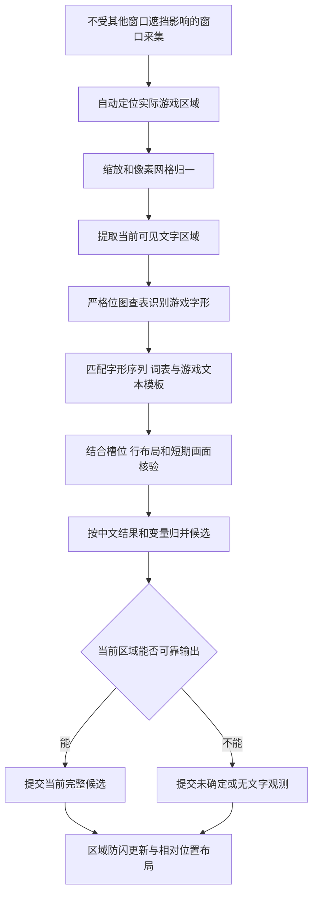

# 公共文本库驱动的识别与匹配方案

状态：已确认使用归一化后的严格字形查表及字形序列匹配，支持完整、宽高比正确且至少为原生分辨率的等比放大画面；区域防闪规则与 Python 建库已确认。Q32 确认 Java 8、JavaFX 8 与 JNA 直接系统采集，尚未开始产品实现。具体契约和验收细则随总设计提交最终确认。

## 目标与失败归因

未匹配只作兜底，系统需要通过自动建库和运行时识别提高覆盖。调低匹配门槛造成错译不能算覆盖率提升，也不能把大量异常条目转交用户逐条处理。

需要分开定位五类失败：游戏区域或文字区域提取错误；字形识别不足；库中缺少正确原文或可见片段；缺少正确中文对应；已有正确候选却没有选对或显示到当前画面。每类失败应能通过回放重现，并进入对应的自动化改进流程。

## 运行流程设计

### 严格字形匹配

利用游戏自带点阵字体和字符映射，优先采用恢复点阵后的严格位图相等查表。字体配置覆盖普通字形、战斗附加字形以及浊点、半浊点的组合规则。默认方案不使用最近字符猜测或编辑距离改写来掩盖识别失败。

严格匹配建立在正确的游戏区域、原生像素网格和二值化结果上。现有 16 张图已经含有中间色与非整数缩放，尚未证明可以确定性恢复全部原始字形。因此第一个技术验证关卡是测量归一化后是否能得到稳定、与原字库完全相同的位图。没有严格命中时，优先重新定位、检查网格和字体配置、重取稳定帧与归一化。

日版有多个 Unicode 假名共用同一点阵字形。已确认先确定性识别字形标识，再用库中相同字形序列检索文本，无需把这种等价关系解释成视觉模糊。[原始字符映射](https://github.com/Narishma-gb/pokegreen/blob/master/constants/charmap.asm) 显示原文时保留字符别名或来源，避免假定每个字形唯一对应一个 Unicode。

### 文本与变量匹配

固定专名与对应词表匹配，句子匹配固定字形序列和变量结构；同屏区域类别、行数、位置和变量格式用于排除不可能的候选、定位可见片段。源脚本里的换行与控制符由建库阶段展开，不能把源文件格式差异当作 OCR 容错问题。

名字和昵称允许自由字符串，有明确对照记录时翻译，没有时保留原文；数字保持当前画面读到的值，不能用库中某个实例的值覆盖。共享字形、来源变体或多个相同句子可能产生多个文本候选，但不据此改变严格识别得到的字形。

### 利用布局和短期证据

已允许融合同一页面的相邻帧，以及用紧邻的已见片段辅助定位当前滚动位置；历史证据不能覆盖当前画面，也不能引入尚未显示的内容。

需要识别翻页、滚动和菜单切换，防止把前后页面混成一句话。完整帧重复不能被当成多份独立证据。短期状态边界、代次与清理规则见 [总设计](design.md) 和 [数据契约](data-model.md)；拿不准页面连续性时不继承历史证据。

### 按实际中文结果消歧

已确认：若多个候选最终产生相同中文和相同变量填充值，可以作为同一输出候选处理，不要求唯一内部来源 ID。

如果所有可用画面和短期证据相同，而正确中文确实不同，降低阈值不能补足缺失信息。此类问题需要新的可见证据、可共享的中文表达或保留未确定状态，不能虚构唯一来源。

## 自动建库方向

优先导入已有结构化文本、标签和工作表对照，保留原始来源。按已核验的标签与语料对应生成候选，再用变量、控制码、固定专名、版本归属和文本内容作一致性检查。大模型辅助解决剩余的语义配对和补译，结果经核查后固化为本地资源。

共同内容合并，必要变体保留；显示片段另行对齐。标签相同、自动匹配列有值或大模型给出配对都不足以单独证明对应正确。现有汉化的措辞和语义修订遵守 ADR 0003，不借建库过程进行全面重译。

## 已确认的质量目标

评测单位应是有标注的可见文本区域或片段，避免用重复视频帧数量扩大分母。动态姓名和数值按预期输出核对；应保留的原文名字不算翻译失败，未匹配兜底不能算自动中文成功。

| 指标 | 要回答的问题 |
| --- | --- |
| 原文与译文资源覆盖率 | 实际出现的内容是否已有正确的原文模板、可见片段和中文对应 |
| 严格字形还原率 | 定位和归一化后是否得到与字库完全相同的正确位图 |
| 自动覆盖率 | 全部标注单位中，有多少能在规定时间内自动给出完整且被系统接受的输出 |
| 自动输出正确率 | 已自动输出的内容中，有多少中文、变量和当前可见范围全部正确 |
| 失败分布和延迟 | 哪个场景或环节造成失败，稳定可见后多久更新 |

已确认首版目标为自动覆盖率至少 98%、自动输出正确率至少 99.5%，覆盖六类目标场景并分别报告；稳定有效画面到达采集端后，显示延迟 P95 不超过 300 ms。这些是工程目标，不是已测能力；计数和测量基准见 [验收方案](validation.md)，具体清单规模及场景权重在实施时固定。不能通过排除失败样本、把兜底计作成功或仅汇报总平均来满足指标。

## 译文提交

已确认按区域暂留完整旧结果，新结果确认后整块替换，并对真实消失和长期无法更新设置独立规则。150 ms 后标记更新中、最长暂留 1 秒、确认无文字持续 150 ms 后清除，均作为可调初值；详见 [译文更新与相对位置布局](display-design.md)。

## 已确认的采集方向

采用类似 OBS 的窗口采集，其他窗口遮挡目标窗口时仍能采集。默认自动识别实际游戏区域、排除非游戏内容，并处理窗口移动和缩放；只有自动定位失败时才提供人工框选。接口核查、自动定位设计及验证范围见 [窗口采集与游戏区域定位](capture-design.md)。
